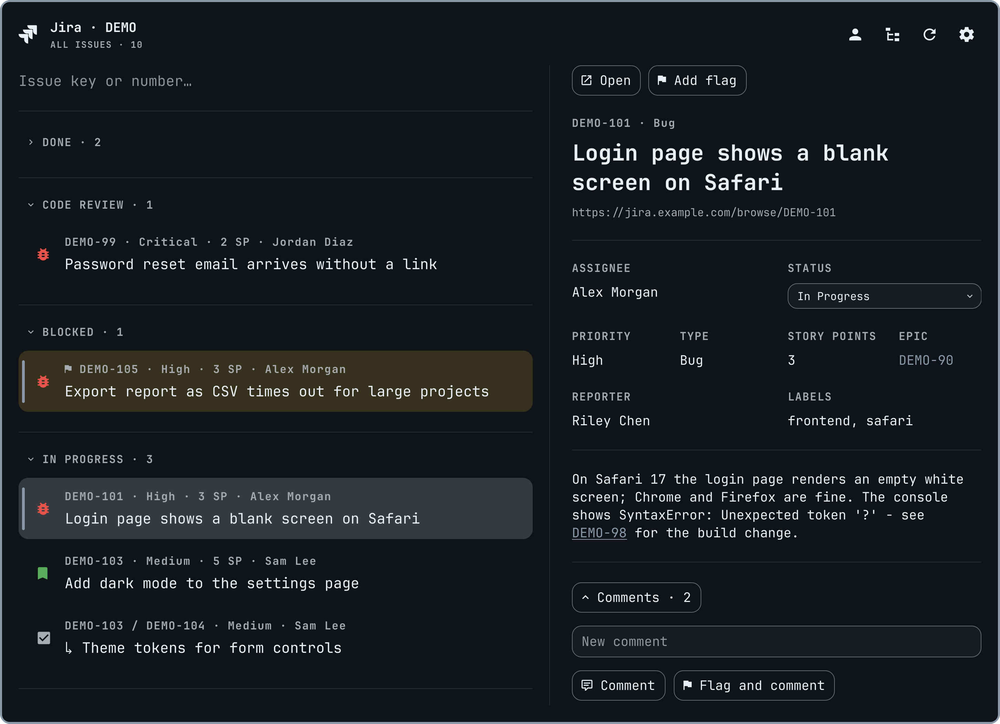

# Jira

My Jira Server issues in one project: a list and an editable issue card.



## Keys

Letters always go to the search field. The cursor walks the whole window:

- ↑/↓ — the list; the card follows the issue under the cursor
- ↑ from the first row — the header buttons, ←/→ along them, ↓ back to the list
- → or Tab — the card: ↑/↓ along its buttons and links as they stand on screen, ←/→ within a row, ← from the first one back to the list; a row farther than a third of the card away scrolls the card first, so a long description reads with the arrows
- Enter — what a click does (the status opens its list, the comment field takes typing; ↓/↑ leave it)
- settings: ↑ from the address — Back, ↓ from the token — Save, → Cancel
- Esc — a step back: settings → out of a card field → card or header to the list → back along the links followed → clear the search → close

Links inside the description and comments open with the mouse only.

## Without the bar icon

The modal and the IPC target (`omarchy-shell predmaxim.jira toggle`) live in
the bar widget, so the widget stays in the bar; to hide its icon and open Jira
from a hotkey only:

```
omarchy bar set predmaxim.jira showIcon false --json
```

`true` brings the icon back.
